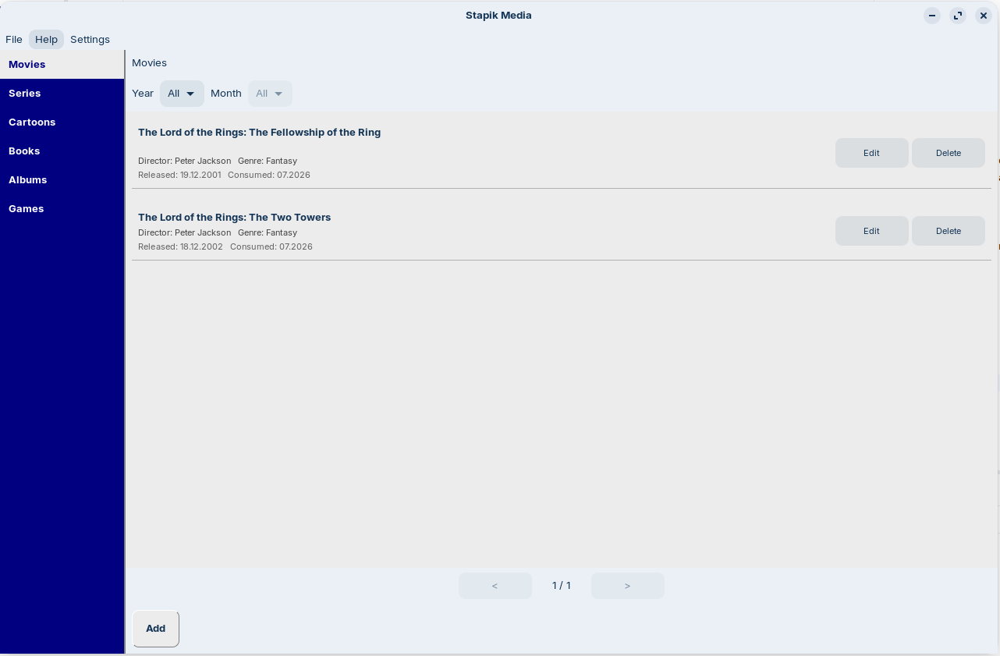
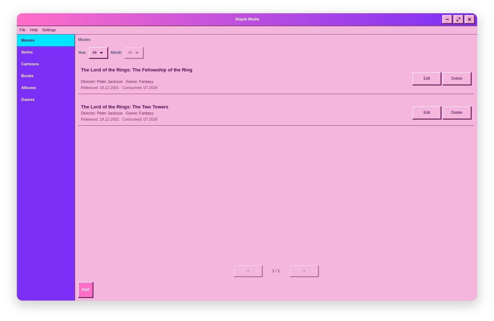
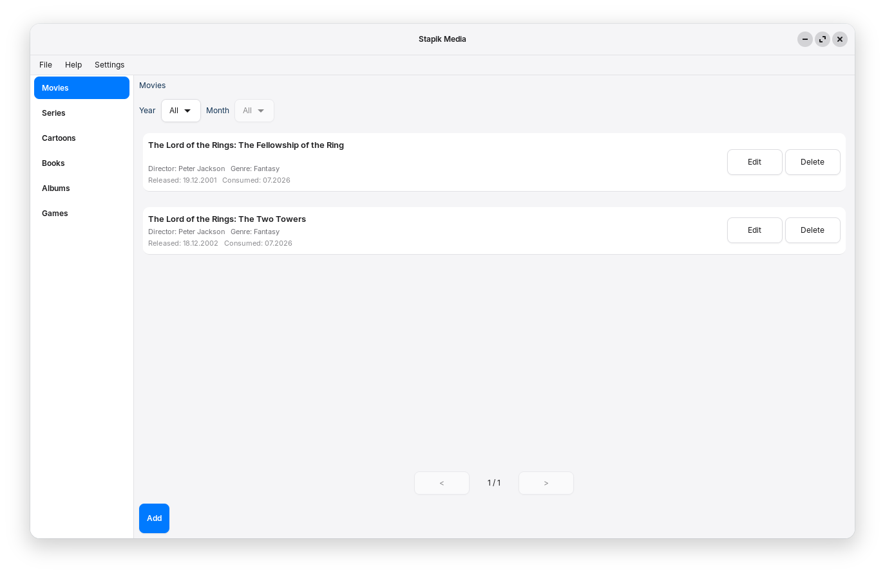

# Stapik Media

A desktop media-tracking application for Linux, written in C++20 using GTK4/gtkmm. Styled after the retro old-school aesthetic.



## Features

- **Category sidebar** - browse your entries by type: Movies, Series, Cartoons, Books, Albums, Games.
- **Media entries** - add, edit and delete entries, with fields tailored to each category (director/genre for movies and series, author/genre/audiobook for books, performer/publisher/genre for albums, studio/publisher/platform for games).
- **Release date with adjustable precision** - store a full date, a month and year, or just a year, depending on how much you actually know about older titles.
- **Consumption date** - track the month and year you watched/read/listened/played each entry, defaulting to the current month and year when adding a new one
- **Filtering and search** - narrow the list down by consumption year, optionally by month within that year, and search entries by title ignoring case and diacritics.
- **Pagination** - entries are shown 10 per page.
- **Undo / Redo** - add, edit and delete are undoable from the Edit menu (Ctrl+Z / Ctrl+Shift+Z).
- **Cloud sync** - background synchronization with a self-hosted Stapik Cloud server, with automatic conflict resolution based on timestamps and a status indicator in the window.
- **Yearly archives** - only the current year is kept in the main cloud document; older years are archived separately and downloaded on demand.
- **CSV export** - all entries to a CSV file that opens correctly in Excel (UTF-8 with a byte order mark and the separator of the current language).
- **Printing and PDF** - the list you see (category, filters and search, every page) can be printed or saved as a PDF.
- **Settings window** - language, theme, font and the update check in one place.
- **Built-in tutorial** - a help window with a contents tree (Help menu or F1), available in Polish, English and German.
- **Update notice** - the program tells you when a newer version is published on GitHub; nothing is downloaded automatically.
- **Log viewer** - Help menu, useful when reporting a problem.
- **Multilingual UI** - Polish, English and German interface with instant switching.
- **Auto-save** - data saved locally after every change, with atomic writes and rotating backups (at most one every five minutes) that can be restored from the File menu.
- **Remembers your setup** - window size, last selected category, language and theme.
- **Retro aesthetic** — classic look with raised buttons, blue navigation bar and grey cells.
- **Five themes** - Classic, Classic Pink, Modern, Dark and Neoclassic, switchable live from the menu.

## Dependencies

- CMake 4.2 or newer and a C++20 compiler
- `gtkmm-4.0`
- `libcurl`
- `libsodium` and `zlib`
- `libsecret` (Linux, optional: keeps the cloud API key in the system keyring) and `libx11` (Linux, optional: remembers the window position)
- [`stapik-common`](https://github.com/stapik/stapik-common) (fetched automatically via CMake FetchContent)
- `nlohmann/json` (fetched automatically via CMake FetchContent, transitively provided by `stapik-common`)

On Ubuntu/Debian:
```bash
sudo apt install libgtkmm-4.0-dev libcurl4-openssl-dev libsodium-dev zlib1g-dev libsecret-1-dev libx11-dev
```

Building a `.deb` package additionally requires `dpkg-dev` (used to auto-detect runtime dependencies):
```bash
sudo apt install dpkg-dev
```

Running the unit tests needs nothing extra: GoogleTest is fetched automatically when the tests are enabled.

## Building

```bash
git clone https://github.com/Stapik-Group/stapik-media
cd stapik-media
cmake -B cmake-build-release -DCMAKE_BUILD_TYPE=Release
cmake --build cmake-build-release
```

### Continuous integration

GitHub Actions use the reusable workflows of `stapik-common`:

| Event | What happens |
|-------|--------------|
| push to any branch | nothing |
| pull request from `develop` to `main` | build and unit tests on Linux and Windows |
| merge into `main` | nothing |
| release published (tag `vX.Y.Z`) | the tag is compared with the version in `CMakeLists.txt`, then a `.deb` for every supported distribution, the Windows installer and the portable ZIP are attached to the release |

Bump the version in `CMakeLists.txt` before creating the release.

### Running the tests

```bash
cmake -B cmake-build-debug -DCMAKE_BUILD_TYPE=Debug -DSTAPIK_MEDIA_BUILD_TESTS=ON
cmake --build cmake-build-debug --target stapikmedia_tests
ctest --test-dir cmake-build-debug --output-on-failure
```

## Installation

### Option 1 — Download prebuilt `.deb` (recommended)

Download the `.deb` package for your distribution from the [Releases page](https://github.com/Stapik-Group/stapik-media/releases), then install it:

```bash
sudo dpkg -i stapikmedia*.deb
sudo apt install -f   # resolves any missing runtime dependencies
```

### Option 2 — build `.deb` from source

If you'd rather build the package yourself:

```bash
cd cmake-build-release
cpack -G DEB
sudo dpkg -i stapikmedia*.deb
sudo apt install -f
```

Either option installs the app to `/opt/stapikmedia/` (binary and resources), with a launcher at `/usr/bin/stapikmedia`, a `pl.stapik.media.desktop` entry and an icon under `/usr/share`, so it appears in the desktop environment's application menu.

### Option 3 — per-user install (no sudo required)

```bash
cmake -B cmake-build-release -DCMAKE_BUILD_TYPE=Release \
      -DCMAKE_INSTALL_PREFIX="$HOME/.local/opt/stapikmedia" \
      -DSTAPIK_APP_SYSTEM_PREFIX="$HOME/.local"
cmake --build cmake-build-release
cmake --install cmake-build-release
```

Installs the binary and resources to `~/.local/opt/stapikmedia/`, with a launcher at `~/.local/bin/stapikmedia`. Make sure `~/.local/bin` is in your `PATH`.

## Windows

Every release has two Windows assets:

- `stapikmedia-<version>-setup.exe` - an installer (per user by default, available in English, Polish and German);
- `stapikmedia-<version>-windows-portable.zip` - a self-contained folder: unpack it anywhere and run `stapikmedia.exe`.

Your data is kept per user and survives updates and uninstalling:

| What | Where |
|------|-------|
| entries, backups, cloud connection | `%APPDATA%\stapikmedia\data` |
| settings | `%APPDATA%\stapikmedia\config` |
| log file | `%LOCALAPPDATA%\stapikmedia\cache\stapik.log` |

Start the program with `--portable` to keep all of that in a `portable` folder next to the executable instead.

To build it yourself, use an MSYS2 UCRT64 shell with `gcc cmake ninja pkgconf gtkmm-4.0 curl libsodium zlib adwaita-icon-theme hicolor-icon-theme` (prefixed `mingw-w64-ucrt-x86_64-`):

```bash
cmake -S . -B build -G Ninja -DCMAKE_BUILD_TYPE=Release
cmake --build build --target stapikmedia_windows_bundle
```

The folder appears in `build/stapikmedia-windows/`. The targets `stapikmedia_windows_portable` and `stapikmedia_windows_installer` (needs Inno Setup 6.3 or newer) pack it. Running `stapikmedia.exe --self-test` checks the installation (resources, themes, tutorial, translations, TLS) and exits with a non-zero code when something is missing; the result is written to the log file.

## Command line

| Flag | Effect |
|------|--------|
| `--version` | prints the name and the version and exits |
| `--log-level=LEVEL` | `debug`, `info`, `warning` or `error` |
| `--data-dir=DIR` | keeps data, settings and cache in `DIR/{data,config,cache}` |
| `--portable` | the same, in a `portable` folder next to the executable |
| `--reset-settings` | moves `settings.json` aside as a `.bak` file before starting |
| `--safe-mode` | does not restore or save the window state |
| `--self-test` | checks the installation and exits (see above) |

## Uninstalling

### If installed via `.deb`

```bash
sudo dpkg -r stapikmedia
```

### If installed per-user

```bash
rm -rf ~/.local/opt/stapikmedia
rm ~/.local/bin/stapikmedia
rm ~/.local/share/applications/pl.stapik.media.desktop
rm ~/.local/share/icons/hicolor/256x256/apps/stapikmedia.png
```

Either way, your media data and cloud config remain at `~/.local/share/stapikmedia/`, and your settings at `~/.config/stapikmedia/` — see [Data Storage](#data-storage) below if you want to remove those too.

## Cloud Sync

The app supports synchronization via [Stapik Cloud](https://github.com/Stapik-Group/stapik-cloud) — the same server and protocol used by Stapik Calendar. Go to **File → Connect to cloud**, enter the server URL and API key, and press **Check** to test the connection before you confirm. An optional passphrase turns on end-to-end encryption: the documents are encrypted on your device and the server only stores unreadable data. If a connection is already configured, the app reconnects automatically on startup. Plain HTTP is accepted, but the connection dialog warns that it is not secure. **File → Disconnect from cloud** removes the API key and the connection settings from the device and leaves your entries untouched.

The API key and the passphrase are kept in the system keyring (Secret Service on Linux, Credential Manager on Windows); without a keyring they are kept in a file readable only by your user, and the app says so after connecting. When the API key is about to expire, the app warns you in time.

**Version 1.3.0 requires Stapik Cloud 1.2.0 or newer.** Stay on an older Stapik Media if you use an older cloud.

Synchronization runs in the background and never blocks the window. A status indicator at the bottom shows whether the data is up to date, being synchronized, offline, in conflict or failed. You can trigger a sync manually from **File → Sync**.

Once connected, the app compares the local file and the cloud copy using a `lastUpdate` timestamp and keeps whichever one is newer, overwriting the other **as a whole document**. There is no field-level or entry-level merging — if both copies changed since the last sync, the older one is fully replaced. Every change is saved locally first and pushed to the cloud shortly afterwards (changes made in quick succession are batched). Writes are optimistic-concurrency-checked: if another device saved a newer version in the meantime, the server's copy is fetched and the conflict is resolved by the same rule. If the cloud is unreachable, the change stays saved locally and the app retries with a growing delay. Closing the window right after an edit waits briefly for the pending upload.

### Yearly archives

To keep the synchronized document small, entries are split by the **year they were consumed**:

- entries from the current year (and later) live in the main cloud document `media.json`;
- entries from earlier years are archived, one document per year, as cloud partitions.

At startup only the main document and the archives you already have locally are synchronized. Selecting an older year in the filter downloads that year's archive from the cloud if it is not on this device yet. Until it arrives the list for that year may look empty for a moment.

If you try to add or move an entry into an archived year that exists in the cloud but has not been downloaded yet, the app asks you to select that year in the filter first, so a partial local copy can never overwrite the cloud archive.

When a new year starts, the previous year is archived automatically on the next launch. The same happens once after upgrading from a version that kept all years in a single document.

**Caution for multi-device use:** since conflict resolution is whole-document, editing the same year offline on two different machines before either one reconnects can still cause one set of changes to be discarded. Stapik Cloud keeps a version history of every write, so a discarded document isn't gone permanently, but the app itself doesn't yet expose a way to browse or restore old versions. After upgrading to a version with yearly archives, update the app on all your devices: older versions only know the single-document layout and will not see archived years.

The app talks to the Stapik Cloud `/documents/{slotKey}` endpoint (slot key `media.json`), authenticated via an `x-api-key` header; archives use the same endpoint with a partition per year. See the [Stapik Cloud API reference](https://github.com/Stapik-Group/stapik-cloud) for details.

## Data Storage

Local data is stored in `~/.local/share/stapikmedia/`:

- `media.json` — the main document (current year), written atomically and wrapped with a schema version and a `lastUpdate` timestamp;
- `media-YYYY.json` — one archive per earlier year, in the same format;
- `*.bak` — up to five backups of each document, at most one every five minutes; **File → Restore from backup…** restores the main document (the entries of the current year);
- `config.json` — the cloud connection (the API key and the passphrase only when no system keyring is available).

Language, theme, font, window state, the last selected category and the update check are kept in `~/.config/stapikmedia/settings.json`.

A log file `stapik.log` is written to `~/.cache/stapikmedia/` when the program is started from a launcher rather than from a terminal; **Help → View log** shows the same records in the window.

A failed save is reported in the window, and the changes stay in the open window until the file can be written.

A damaged data file is moved aside instead of being overwritten, and the app starts with an empty list that you can restore from a backup or from the cloud. A file written by a newer version of the app is never modified: the app shows a message and stays read-only.

If you are upgrading from an older version, your existing `media.json` is converted automatically on first launch (the original is kept as a `.bak` file) and every entry gets a stable ID.

## Themes

Switch between five themes in **Settings → Settings…**: Classic (the original retro look), Classic Pink, Modern (flat, minimal), Dark, and Neoclassic (a soft blue-and-beige look). The choice applies instantly and is remembered between launches.




## TODO

- [x] Category-based sidebar with per-type entry fields
- [x] Filtering by consumption year/month
- [x] Pagination
- [x] Search by title
- [x] CSV export, printing and PDF export
- [x] Windows installer and portable ZIP
- [x] Built-in tutorial
- [x] Cloud sync with conflict resolution
- [x] `.deb` package for easier distribution
- [x] Multiple themes (Classic / Modern / Classic Pink / Dark / Neoclassic)
- [x] Undo / Redo
- [x] Yearly archives in the cloud
- [x] Unit tests
- [ ] Import from an existing spreadsheet (CSV/XLSX)
- [ ] Sort options (by title, release date, consumption date)
- [ ] Flatpak package